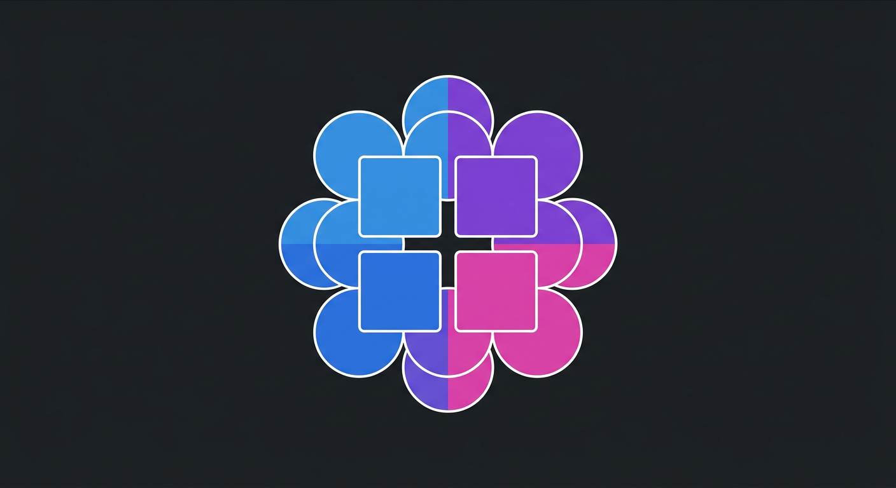
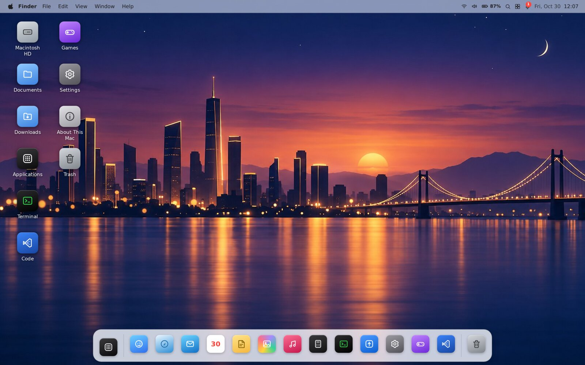
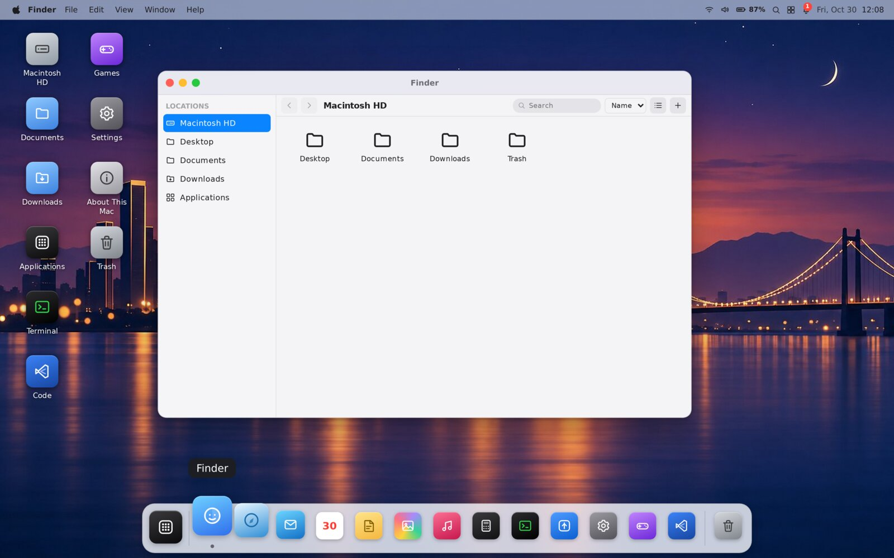

<p align="center">
  
</p>

<h1 align="center">MacWeb OS</h1>

<p align="center">
  A fully in-browser, macOS-inspired desktop simulator — boot screen, Dock, Spotlight,<br/>
  Control Center, Notification Center and 13 working apps, built with Angular 22, Signals and strict TypeScript.
</p>

<p align="center">
  <a href="https://hoseinsedaqat.github.io/mac-OS/"><strong>🔴 Live demo</strong></a>
  ·
  <a href="#features">Features</a>
  ·
  <a href="#getting-started">Getting started</a>
  ·
  <a href="#built-in-apps">Apps</a>
  ·
  <a href="#project-structure">Structure</a>
</p>

<p align="center">
  
  
  
  
  
  
</p>

> **Not affiliated with Apple.** MacWeb OS is an original, independently built web app only *inspired* by macOS's look and feel. It is not an official Apple product, is not endorsed by Apple, and does not claim to be real macOS. All wallpapers, icons and the logo are custom/AI-generated artwork created specifically for this project.

---

## ✨ What is this?

MacWeb OS re-creates the *feel* of using a Mac — entirely as a static, client-side web app. There is **no backend, no API keys, and no real operating-system access**: every window, file, note, email and setting lives in your browser (`localStorage` + `IndexedDB`) and nothing ever leaves the tab.

It was built as a showcase of what a modern, standalone-component, Signal-driven Angular app can do: a real window manager with drag/resize/z-order, a persisted virtual filesystem, 13 fully working apps, and a UI that sweats details like keyboard shortcuts, dark mode, reduced-motion support and graceful storage fallbacks.

<p align="center">
  
  <br/>
  <sub>The desktop: menu bar, desktop icons, and the Dock, over the default <em>Night City</em> wallpaper</sub>
</p>

<p align="center">
  
  <br/>
  <sub>Finder open in a real, draggable/resizable window — one of the 13 built-in apps</sub>
</p>

---

## 📚 Table of contents

- [What is this?](#-what-is-this)
- [Features](#features)
- [Built-in apps](#built-in-apps)
- [Tech stack](#tech-stack)
- [Getting started](#getting-started)
- [Available scripts](#available-scripts)
- [Running tests](#running-tests)
- [Building for production](#building-for-production)
- [Deploying to GitHub Pages](#deploying-to-github-pages)
- [Project structure](#project-structure)
- [Adding a new app](#adding-a-new-app)
- [Simulated vs. real capabilities](#simulated-vs-real-capabilities)
- [Troubleshooting](#troubleshooting)

---

## Features

### 🖥️ System shell
- **Boot flow**: skippable splash → animated boot → lock screen (live clock/date, optional demo password, Enter-to-login) → login → desktop, modeled as an explicit, illegal-transition-rejecting state machine (`SystemStateService`).
- **Sleep / resume**: the Page Visibility API puts the simulated machine to sleep when the tab is hidden and wakes it on return, preserving every open window and its state.
- **Restart / Shut Down** (via the system menu — click the logo mark in the top-left corner of the menu bar): closes every open window and replays the boot animation back to the lock screen (Restart), or shows a black "powered off" screen that turns back on with a click/keypress (Shut Down) — clearly disclosed as simulated, since a browser tab can't actually power off a device.
- **Menu Bar**: system menu (logo mark, top-left), active app name, File/Edit/View/Window/Help, live clock & date, simulated Wi-Fi/battery/volume indicators, search, Control Center and Notification Center entry points.
- **Dock**: a dedicated Launchpad button plus built-in apps, open-app indicators, hover magnification, minimize/restore animation, single-instance activation, auto-hide, resizable, right-click menu — all persisted.
- **Window Manager**: a single `WindowManagerService` owns every window's id/app/title/rect/open/minimized/maximized/active/z-index/drag/resize state, clamps windows to the viewport, dims inactive windows, and prevents accidental text selection while dragging.
- **Launchpad**: a full-screen, category-filterable app grid with original gradient tile artwork. Tiles for real apps open the actual app; a handful of extra tiles shown only for visual completeness (Preview, Maps, Automator, Chess, Clock, …) clearly disclose that they are not implemented in this demo instead of silently doing nothing.
- **Spotlight** (<kbd>⌘</kbd>/<kbd>Ctrl</kbd>+<kbd>Space</kbd>): fuzzy search across apps, simulated files and notes; <kbd>Esc</kbd> closes it.
- **Notification Center**: dismiss individually or all at once, jump to the originating app, empty state.
- **Control Center**: live Appearance/Volume/Dock/Keyboard-&-Display-brightness controls plus simulated Wi-Fi/Bluetooth/AirDrop/Focus/Stage Manager/Screen Mirroring toggles and a quick-action grid — every action either reflects real `SettingsService` state or performs a real, disclosed effect, never a dead click.
- **Keyboard shortcuts**: <kbd>Esc</kbd>, <kbd>Enter</kbd>, <kbd>Ctrl/Cmd+Space</kbd> (Spotlight), <kbd>Ctrl/Cmd+W</kbd> (close window), <kbd>Ctrl/Cmd+M</kbd> (minimize), <kbd>Ctrl/Cmd+Q</kbd> (quit app), <kbd>Alt/Option+Tab</kbd> (switch app) — all implemented so they never interfere with typing in text fields.

### 💾 Persistence
- **LocalStorage** (`StorageService`) for every preference: namespaced, versioned, and falls back to an in-memory store if LocalStorage is unavailable or full (private browsing, quota exceeded) — the UI is warned, nothing crashes.
- **IndexedDB** (`FileSystemService`) for the simulated filesystem (Finder/Trash). If IndexedDB is unavailable, the whole app transparently falls back to an equally functional **in-memory filesystem** for that session.
- **Reset Environment** in Settings clears everything (with confirmation).

### 🎨 Visual / UX
- Soft corners, shadows and blur, light/dark mode via CSS custom-property design tokens, short animations that respect `prefers-reduced-motion`.
- Responsive: fullscreen windows and a compact Dock on tablet/mobile breakpoints.
- Accessible focus states throughout.

---

## Built-in apps

13 apps, all fully functional — nothing decorative or a dead click:

| App | What it does |
|---|---|
| 🗂️ **Finder** | Simulated filesystem backed by IndexedDB: sidebar, list/grid view, sort, search, create/rename/move/delete, multi-select, context menu. |
| 🌐 **Safari** | Tabs with their own back/forward history, bookmarks, address bar, local sample pages. External URLs never get embedded in an iframe — they open in a real new browser tab. |
| 📝 **Notes** | Folders, full CRUD, search, autosave, remembers the last selected note. |
| 📅 **Calendar** | Month view & navigation, day selection, create/edit/delete events, today highlighted, persisted. |
| 🧮 **Calculator** | Four-function arithmetic implemented with a pure, dependency-free engine (**no `eval`/`Function`**), percent, sign toggle, divide-by-zero handling, full keyboard support. |
| ⚙️ **Settings** | Appearance, Wallpaper, Theme, Accent color, Dock, Desktop, Sound, Date & Time, Accessibility, Storage, About — every change applies immediately and persists; includes Reset to Defaults. |
| ⌨️ **Terminal** | A **safe, allow-listed** command simulator (`help`, `about`, `whoami`, `date`, `echo`, `ls`, `pwd`, `clear`, `neofetch`). Never executes real shell commands, no `eval`/`Function`. |
| 🖼️ **Photos** | Grid/detail/lightbox views, albums, search, graceful placeholder on image load failure. |
| 🎵 **Music** | Sample tracks with play/pause/next/previous, progress and volume — clearly labeled **Demo mode**. |
| ✉️ **Mail** | Inbox/Sent/Drafts with sample data, search, draft/delete/mark-read — clearly labeled **Demo mode**; no message is ever actually transmitted. |
| 🛍️ **App Store** | Browse/search/filter by category, app detail view, Install/Open toggle that persists per app. |
| ℹ️ **About This Mac** | Simulated specs (never presented as real hardware), shows live app/window counts and a storage estimate. |
| 🗑️ **Trash** | List, restore, permanently delete (with confirmation), empty (with confirmation) — backed by `FileSystemService`. |

---

## Tech stack

- **Angular 22** — standalone components only, no NgModules, zoneless change detection.
- **TypeScript** in `strict` mode.
- **Signals** for all application state (no NgRx/Redux/other state library).
- **SCSS** with a token-driven design system (`src/styles/_tokens.scss`, `_typography.scss`, `_utilities.scss`).
- **Custom inline SVG icons** (`shared/components/icon`) — no icon library dependency.
- **Vitest** (via `@angular/build:unit-test`) for unit tests.
- Zero runtime dependencies beyond Angular itself + RxJS.

---

## Getting started

```bash
cd mac-web-os
npm ci          # or: npm install
npm start       # ng serve — http://localhost:4200
```

No environment variables, API keys, or backend services are required.

## Available scripts

Run from inside `mac-web-os/`:

| Command | Description |
|---|---|
| `npm start` | Starts the dev server (`ng serve`). |
| `npm run build` | Production build to `dist/mac-web-os/browser`. |
| `npm run watch` | Development build in watch mode. |
| `npm test` | Runs the Vitest unit test suite once. |
| `npm run e2e:install` | One-time setup: downloads the Playwright Chromium browser. |
| `npm run e2e` | Runs the Playwright end-to-end suite against a real browser. |

## Running tests

```bash
cd mac-web-os
npm test
```

The suite covers 100+ scenarios across 20+ spec files, including:
- the full splash → boot → lock → login → desktop → sleep/wake state machine, including rejected illegal/duplicate transitions;
- the window manager (open/close/focus/minimize/maximize/resize, single-vs-multi-instance apps, viewport clamping, z-order);
- every data-backed app's store (Notes, Calendar, Mail, App Store installs) including persistence across reloads;
- the Calculator engine (all four operators, chaining, percent, sign toggle, divide-by-zero recovery) with **zero `eval`/`Function` usage**;
- the Terminal's allow-listed command parser, proving unknown/malicious input is never executed;
- `StorageService`'s in-memory fallback when `localStorage.setItem` throws;
- `FileSystemService`'s in-memory fallback when IndexedDB is unavailable.

### End-to-end tests

Unit tests run against mocked/`TestBed` state, so they can't catch bugs that only show up from real pointer interactions against the live DOM (drag, double-click, focus order, CSS visibility). [`mac-web-os/e2e/`](mac-web-os/e2e) holds a [Playwright](https://playwright.dev) suite that drives a real browser through the actual boot → lock screen → login → desktop flow, then exercises window management (open/maximize/minimize/close) exactly like a user would.

```bash
cd mac-web-os
npm run e2e:install   # one-time: downloads the Playwright browser
npm run e2e
```

This runs automatically in CI on every pull request (see [`.github/workflows/ci.yml`](.github/workflows/ci.yml)).

## Building for production

```bash
cd mac-web-os
npx ng build --configuration production
```

Output is written to `dist/mac-web-os/browser/`. The app is a 100% static bundle — it can be served from any static file host.

## Deploying to GitHub Pages

A ready-to-use workflow lives at [`.github/workflows/deploy.yml`](.github/workflows/deploy.yml). It triggers on every push to the default branch and can also be run manually from the **Actions** tab (`workflow_dispatch`).

What it does:

1. Installs dependencies with `npm ci` and runs the unit test suite — the deploy fails fast if a test regresses.
2. **Computes the correct `--base-href` automatically**, handling both GitHub Pages hosting cases:
   - If the repository is named `<user>.github.io` (an org/user root page), it builds with `--base-href /`.
   - Otherwise (a normal project repository, e.g. `mac-OS`), it builds with `--base-href /<repo-name>/`.
3. Runs `ng build --configuration production` with that base href.
4. **Auto-detects the real build output folder** (`dist/<project>/browser`) instead of hard-coding a path, so renaming the Angular project doesn't break the pipeline.
5. Adds a `404.html` (copy of `index.html`) so direct/deep links still load the app, and a `.nojekyll` file so GitHub Pages doesn't mangle any filenames starting with `_`.
6. Uploads the result as a Pages artifact and deploys it with the official `actions/deploy-pages` action, using the modern OIDC-based Pages permissions — no personal access token required.

**One-time repo setup**: in GitHub → Settings → Pages, set the source to **GitHub Actions**. After that, every push to the default branch deploys automatically.

👉 **Live instance:** https://hoseinsedaqat.github.io/mac-OS/

## Project structure

```
mac-web-os/
  src/app/
    core/
      models/      # SystemState, WindowState, AppDefinition, FsNode, Notification, SettingsState
      services/    # SystemStateService, WindowManagerService, ApplicationRegistryService,
                    # SettingsService, StorageService, FileSystemService, NotificationService,
                    # KeyboardShortcutService, DesktopService, SoundService, DialogService, ...
    shell/
      boot/ lock-screen/ login/ desktop/ menu-bar/ dock/
      spotlight/ control-center/ notifications/
    shared/
      components/  # IconComponent (custom SVG set), context-menu, confirm-dialog
      directives/ pipes/ utils/   # clamp, id, date helpers + wallpapers data
    apps/
      finder/ safari/ notes/ calendar/ calculator/ settings/ terminal/
      photos/ music/ mail/ app-store/ about/ trash/
  public/
    wallpapers/   # 9 original wallpapers, default is the stylized "Night City" skyline
    icons/        # app logo
    photos/       # sample AI-generated photos for the Photos app
  src/styles/
    _tokens.scss       # CSS custom properties (design tokens), light/dark, reduced-motion
    _typography.scss
    _utilities.scss
```

## Adding a new app

Every app is decoupled from the shell through `ApplicationRegistryService` + `WindowManagerService`, so adding one never touches Dock/Spotlight/window-manager code:

1. Create `src/app/apps/<your-app>/your-app.component.{ts,html,scss}` as a **standalone** component. Declare `readonly windowId = input<string>('');` (every app receives its hosting window's id this way) and read it from `ngOnInit()` — **not** from a field initializer or the constructor body, because `NgComponentOutlet` only calls `setInput('windowId', …)` after construction.
2. Register it in `ApplicationRegistryService.definitions()`: give it an `id`, `name`, `icon` (must exist in `IconComponent`'s icon set, or add a new one there), `category`, `singleInstance`, dock/launchpad visibility, default window size, and `loadComponent: () => import('../apps/your-app/your-app.component').then(m => m.YourAppComponent)` (lazy-loaded).
3. If it needs to persist data, add a small dedicated `*-store.service.ts` that wraps `StorageService` (localStorage) or `FileSystemService` (IndexedDB) — follow the pattern used by `NotesStoreService` / `CalendarStoreService`.
4. That's it — the new app automatically gets a Dock icon, a Launchpad/App Store entry, window-manager support (drag/resize/minimize/maximize/focus), and Spotlight visibility for free.

## Simulated vs. real capabilities

Everything below is clearly labeled in the UI as simulated and never claims to be a real OS capability:

- **Wi-Fi / Bluetooth / AirDrop / Stage Manager / Screen Mirroring / battery / brightness** indicators and toggles in the Menu Bar and Control Center are simulated — browsers have no API to read or control real hardware state reliably or portably.
- **Screen recording** (Control Center quick action) only flips a labeled in-app flag and shows a toast explaining it — MacWeb OS never captures your real screen.
- **"Screenshot"** (Control Center quick action) saves a placeholder text file named like a screenshot into the simulated Documents folder (visible in Finder) — it is not a real screen capture.
- **Recognise Music** shows a toast explaining there is no real audio input to listen to in a browser demo.
- A handful of **Launchpad tiles** (Preview, Maps, Automator, Books, Chess, Clock, Contacts, Dictionary, FaceTime, Find My, Font Book, Freeform, Home) exist only for visual completeness and open a clearly-labeled "not implemented in this demo" dialog instead of a real app.
- **Music** playback is a **Demo mode** using short, generated sample clips — no licensed streaming catalogue is involved.
- **Mail** sending is a **Demo mode** — composing and "sending" a message only moves it into the local Sent folder; no network call is ever made.
- **Terminal** is a sandboxed command simulator with an allow-listed parser — it can never run a real shell command, and contains no `eval`/`Function`.
- **About This Mac** specs are simulated and explicitly labeled as such.
- The simulated filesystem (Finder/Trash) lives only in this browser tab's IndexedDB; it is not your real computer's filesystem.

## Troubleshooting

- **Blank page after deploying to GitHub Pages**: almost always a wrong `base-href`. Confirm the deployed `index.html` contains `<base href="/your-repo-name/">` (or `/` for a `username.github.io` repo).
- **404s for JS/CSS chunks on Pages**: make sure the Pages source is set to **GitHub Actions** (not "Deploy from a branch") and that the workflow's "Locate build output directory" step found `dist/mac-web-os/browser`.
- **`localStorage`/IndexedDB quota or private-browsing errors**: the app is designed to degrade gracefully (in-memory fallback + a visible warning) instead of crashing; if you still see a hard error, please file an issue with the exact browser/version.
- **Tests fail locally only on first run**: run `npm ci` again inside `mac-web-os/` to make sure `node_modules` matches `package-lock.json` exactly.
- **Adding a new icon**: `shared/components/icon/icon.component.ts` keeps every icon as a hand-authored inline SVG path string in one lookup table — add your new icon's `name` there; unknown names fall back to a generic icon instead of crashing.

---

<p align="center"><sub>Built as an original, from-scratch demo project. Not affiliated with or endorsed by Apple Inc.</sub></p>
